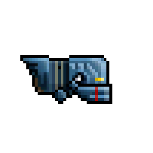
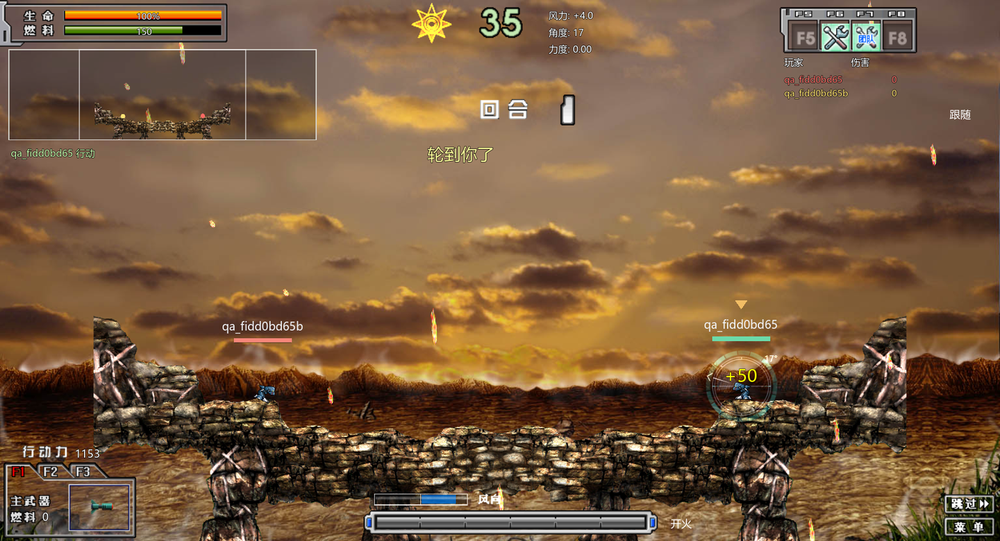
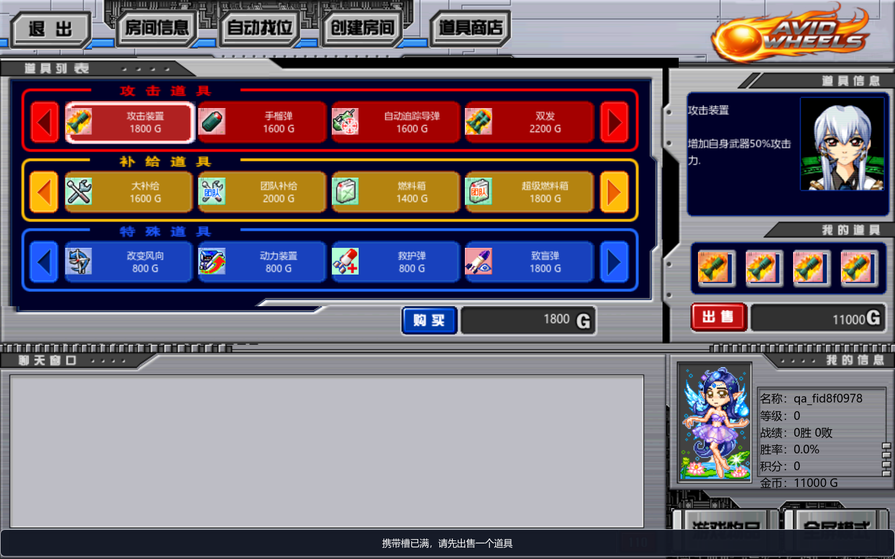

<div align="center">



# 燃烧战车 HD

**保留经典战车与回合制炮战，用 Godot 与 Go 重建宽屏联机体验。**


[](LICENSE)

[本地运行](docs/BUILDING.md) · [玩法与操作](docs/GAMEPLAY.md) · [架构](docs/ARCHITECTURE.md) · [自行部署](docs/DEPLOYMENT.md) · [参与贡献](CONTRIBUTING.md)

</div>

登录后，左右机械门合拢，显示频道选择。进出房间时，上下门板在屏幕中央合成原版火焰标志，再打开显示目标页面。发行记录见 [GitHub Releases](https://github.com/luzaibiu-lang/ranshaozhanche-hd/releases)。

## 项目介绍

燃烧战车 HD 是一个 Godot 4 客户端、Go 权威服务端和 C# Windows 登录器组成的经典炮战重建项目。目标是保留战车、地图、音乐和武器的游戏身份，改善现代显示器上的窗口适配、文字清晰度、动画与操作反馈。

游戏逻辑由本仓库源码实现，运行时无需旧客户端核心、DLL 注入或外置机器人窗口。账号、房间、AI、弹道、可破坏地形、回合、道具和结算由自己的服务端管理，适合本地研究和自行部署。

当前源码版本为 **0.1.17**。已验收的发行平台是 **Windows x64**。Web、Android、iOS 仍待适配。各功能与原版的核对进度见[项目状态](docs/STATUS.md)。

## 实际画面

以下来自 0.1.10 客户端的隔离测试对局。



<details>
<summary>查看道具商城</summary>



</details>

## 主要功能

| 范围 | 实现 |
| --- | --- |
| 经典内容 | 30 种战车、19 张地图、17 种道具及对应的武器与音画资源 |
| 联机对战 | 注册登录、大厅、房间、聊天、队伍、准备、结算和返回房间 |
| AI 陪练 | 房间内设置简单／中等／困难 AI，可选择车型或随机 |
| 战斗 | 服务端弹道和伤害计算、地形破坏、风向、技能、SP 与道具 |
| 现代窗口 | 自适应宽屏、窗口缩放、最大化、F11 全屏、摄像机查看战场 |
| Windows 入口 | 独立登录器、DPAPI 凭据存储、按文件校验的增量更新 |
| 自建服务 | Go 服务、SQLite、可选 TLS、GM 管理页面和接口 |

房间总人数上限为 8。A／B／C／D 的 16 个队伍席位是排列空间，不表示可以同时加入 16 人。

## 快速开始

先安装 **Git、Go 1.26.0、Godot 4.5.1 Standard**。下面的命令从仓库根目录开始执行：

```powershell
git clone https://github.com/luzaibiu-lang/ranshaozhanche-hd.git
cd ranshaozhanche-hd
cd 源码/server
go run . --listen 127.0.0.1:18180 --assets ../client/assets --data ../../.tools/dev-server
```

保留服务端终端，用 Godot 导入 `源码/client/project.godot`，运行项目并连接 `http://127.0.0.1:18180`。注册本地账号后创建房间，添加 AI 即可体验对局。公开源码默认使用本机服务，不依赖运营服务器。

完整构建步骤、资源说明与常见问题见[构建指南](docs/BUILDING.md)。本仓库当前提供源码；预编译 Windows 客户端暂未作为公开 Release 发布。

## 操作速查

| 操作 | 按键 |
| --- | --- |
| 移动／调整角度 | ← → ／ ↑ ↓ |
| 蓄力发射 | 按住空格，松开发射 |
| 选择武器 | 1／2／3 或 F1／F2／F3 |
| 使用携带道具 | F5～F8 |
| 跳过行动 | F9 |
| 切换全屏 | F11 |
| 查看地图 | 鼠标到边缘、右键拖动、滚轮缩放 |

## 源码结构

```text
.
├── 源码/
│   ├── client/       # Godot 游戏、UI、表现和资源
│   ├── server/       # Go 账号、房间、AI、战斗、GM 与测试
│   ├── launcher/     # C# Windows 登录器、更新器和凭据工具
│   ├── tools/        # 构建、分包与本地验收工具
│   └── docs/         # 规则提取表与资源索引
├── docs/             # 开发、部署、玩法、架构和项目状态
├── deploy/           # Linux systemd 示例
└── .github/          # CI 与问题／PR 模板
```

## 开发与质量检查

```powershell
cd 源码/server
go test ./...
go vet ./...
```

Godot 导入、Windows 导出和实际对局复验见[构建指南](docs/BUILDING.md)。[CI 模板](.github/ci/README.md)提供 Go 测试、静态分析和文档链接检查，可由具备工作流权限的维护者启用。图形交互与原版表现仍需要实际运行核对。

欢迎通过 [Issues](https://github.com/luzaibiu-lang/ranshaozhanche-hd/issues) 提交可复现问题，或按[贡献指南](CONTRIBUTING.md)提交 Pull Request。请勿在公开 Issue 中附带账号密码、令牌、数据库或服务器私钥。

## 许可与素材

本项目新编写的程序代码使用 [MIT License](LICENSE)。原游戏衍生的图像、音乐、音效、动画、地图和参考数据，以及第三方组件，**不因代码开源而自动获得 MIT 授权**。素材归原权利人所有；使用、修改或再分发前请核对相应权利和许可。

详细范围与依赖说明见 [NOTICE](NOTICE.md) 和[第三方说明](docs/THIRD_PARTY.md)。本项目是独立重建实现，不代表原游戏官方。
