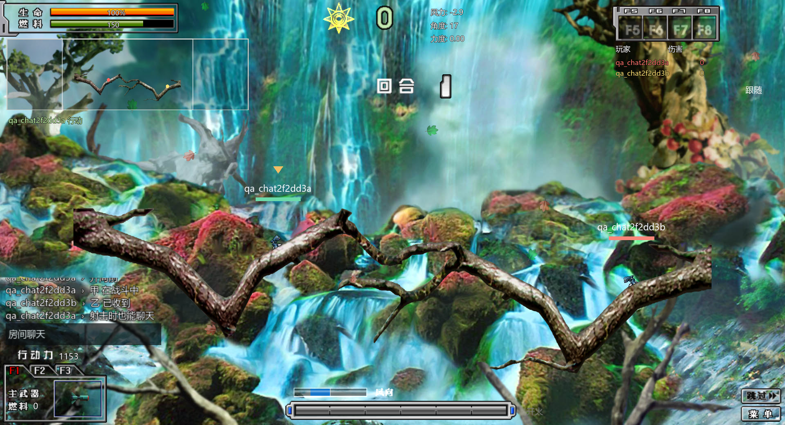
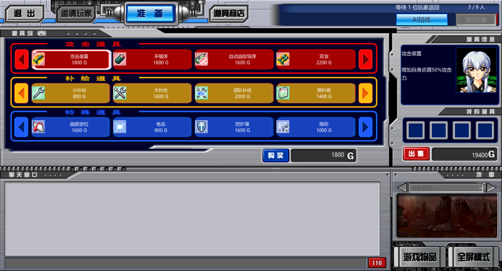

# 0.1.17 对局聊天、结算返回与准备

战斗页面原先没有创建聊天输入框和消息历史，服务端虽能转发房间消息，玩家无法在对局中使用。现在战场左下方显示最近的房间消息，按 Enter 进入输入，再按 Enter 发送，Esc 取消。输入中文和空格、使用光标键时，战车不会移动或蓄力，F2、F9 等战斗快捷键也不会触发。发送成功释放输入焦点，可以继续操作战车。

聊天使用独立请求，不占用或清空开炮、移动、道具的命令确认状态。重复提交同一待发送输入被阻止，空消息不发送，迟到回包经过既有版本/会话检查，不能把新场景退回旧场景。中文内容及普通键盘输入已验证；真实输入法候选窗口、所有输入法组合仍需设备实测。

## 回房状态

| 场景 | 修复后的行为 |
| --- | --- |
| 自己先返回，其他人仍看结算 | 可以准备、取消准备、选车、换组和打开商城；旧结果继续提供给尚未返回的人 |
| 打开商城或游戏物品 | 非房主先收到取消准备的确认，再打开商店；选车、交易等成功后也取消准备，防止准备中的人购物时被直接拉入下一局 |
| 最后一人返回 | 清除旧战斗及返回标记，保留其他人已经选择的准备状态 |
| 房主开始下一局 | 必须所有真人返回、至少两个队伍，且每个非房主真人已准备；新对局仍需要房主主动开始 |
| 房主返回但有人仍看结果 | 可以设置下一局地图、AI；不会重写未返回者的旧战斗结算 |
| 房主离开或最后一名未返回者离开 | 按剩余真人移交房主，满足条件后清除旧结算，不覆盖取消准备状态 |
| 大厅列表 | 区分等待、真正对战和结算；未释放的结算房间仍不允许新玩家加入 |

原有“点击返回后默认准备”继续保留；修正的是之后主动取消、购物或配置产生的未准备状态被无条件覆盖。不会把这次修复描述为彻底取消自动准备。

## 验证

最终 Windows 导出包在非活动桌面、Dummy 音频驱动下执行。两个独立图形客户端验证中文消息双向到达、只发送一次、Esc 取消、输入不误触技能，以及射击播放期间继续聊天，共 30 项断言。实际界面截图已检查。

连续两局返回流程 58 项通过，包含实际点击准备、商城购买/出售、换车、最后一人返回、阻止未准备开局、再次准备开始第二局，以及未返回房主离开后的清理。另完成商城与房间流程 361 项、原生操作及 250 毫秒回包延迟 150 项、移动与原版样本 2364 项、反馈与布局 92 项及雷达背板 7380 像素检查。Go 全量 918 项（含子测试）及静态分析通过。

复测入口为 `qa_battle_chat.py`、`qa_fidelity_ui.py --scenario return` 和 `qa_walking.py`。聊天测试限制使用本机回环服务，测试账号、令牌及原始日志不进入发行包或公开仓库。爬坡及尚待核对的技能差异见 [原版差异核查](ORIGINAL_COMPARISON.md)。

0.1.16 到 0.1.17 只更新 `Game.pck`（470036 字节），旧版副本第一次更新 1 项、再次启动 0 项。损坏文件修复、体积不增长、退役包清理及中断恢复已通过。
