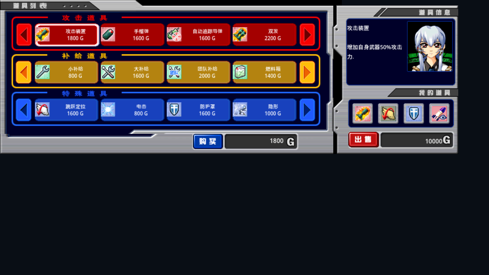
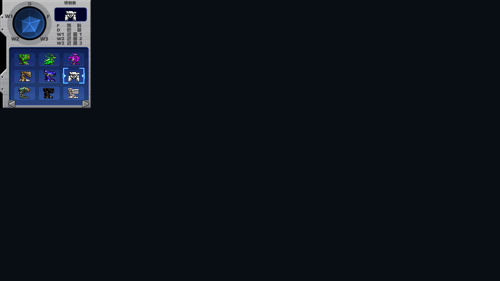
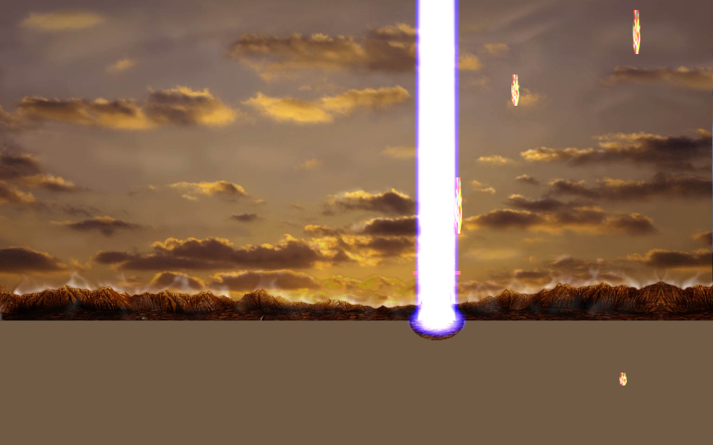

# 0.1.16 战斗反馈与原版界面对齐

本次修正对应玩家报告的库存图标、能力雷达、银蜘蛛 F3、护盾声音、坡面漂移和跳跃定位。

## 原版依据与修正

| 问题 | 原因与修正 | 依据 |
| --- | --- | --- |
| 我的道具图标偏移 | Button 的文本对齐不能定位图标；改用不拦截鼠标的子纹理，原版 31×31 图标在按钮内偏移 (5,5) | `Shop/09.png` 四个槽框及 `ItemIcon` 原图 |
| 能力雷达双圆环 | 93×93 能力贴图左边界写成 25，正确值是 34；其灰色背板与原图逐像素匹配 | `Shop/04.png` 与 `AbilityInfo` 的灰色边缘 |
| 银蜘蛛 F3 缺少地表打击表现 | 原版子弹可以穿地，触及地图底部后在当前地表发动攻击；遗漏的是这次地表攻击的光柱和闪光绑定 | `CWeapon71::update` / `005612f0`、`00560d80`、`004aeff0`；使用 `Effect05` |
| 防护罩无挡弹音 | 服务只计算了挡弹，没有给客户端发出声音事件；新增共享射击时间上的 `shield_hit` | `0052fd60` 明确调用声音编号 0x3f，即 `effect10.wav` |
| AI/远端战车上坡切入地面 | 对两次粗粒度位置进行直线插值，跨过整个坡顶；改为沿与本地预测共用的逐像素地形支持路径取高度 | 已有权威移动/本地预测的地形支持规则；保持网络确认、移动耗油及速度 |
| 跳跃定位横穿地图 | 稀疏运动帧把瞬移之前和之后的位置插值；新增 `warp` 时间点，在该时间直接切换位置 | `00570890` / `00570fa0` 的原版传送门时序；保留 26 tick 开启和 146 tick 门持续时间 |

## 验证范围

在非活动 Windows 桌面运行最终 Windows 导出客户端，使用 Dummy 音频驱动并静音主总线。专项覆盖实际点击库存图标、三种商店尺寸、五个车种雷达、完整坡顶路径、传送前保持/精确换位/之后下落、同时挡弹去重、连续挡弹及音效通道已满时的优先播放。雷达灰色背板另做像素比较。

库存检查还覆盖选中后移开鼠标及依次改选四个槽位：只有当前选中的图标持续着色，之前的图标恢复原色。新图标子节点不会阻挡点击。

| 0.1.16 检查 | 结果 |
| --- | --- |
| 反馈、布局及选中状态 | 92 项通过；雷达灰色背板 7380 个像素比较通过 |
| 武器命中 | 30 辆车共 90 个武器，725 项通过 |
| 真实商城、房间、选车、地图和 AI 配置 | 361 项通过 |
| 真实道具使用及传送门 | 47 项通过 |
| 原生操作及 250 毫秒回包延迟 | 150 项通过 |
| 行走音效 | 30 辆车，146 项通过 |
| 回血效果、战斗时间轴 | 分别 85、77 项通过 |
| Go 测试及静态分析 | 916 项含子测试通过；`go vet ./...` 通过 |

90 个武器使用 Go 生成的权威时间轴，在实际客户端上检查伤害、弹坑、落点反馈；银蜘蛛 F3 的地表光柱逐次检查，包含最后一次攻击后光柱消失。相关脚本是 `qa_feedback_alignment.py` 与 `qa_weapon_hits.py`，Go 用例包括 `TestNativeWarpPreservesPortalBeforeAndAfterTeleport` 和 `TestNativeShieldBlocksWholeShotAndDoubleVolley`。

此版本补回银蜘蛛 F3 的光柱及地面闪光，不把所有原版附带粒子、彩光或高级技能的逐帧一致性标为完成。其他核对边界见 [STATUS](STATUS.md)。

增量发布只更新 `Game.pck` 与 `packs/interface.pck`，共 20536192 字节。旧版副本第一次更新 2 项，第二次更新 0 项；单文件损坏只修复 1 项，未变化资源不重写，体积不增长、退役资源清理与中断恢复均通过。
