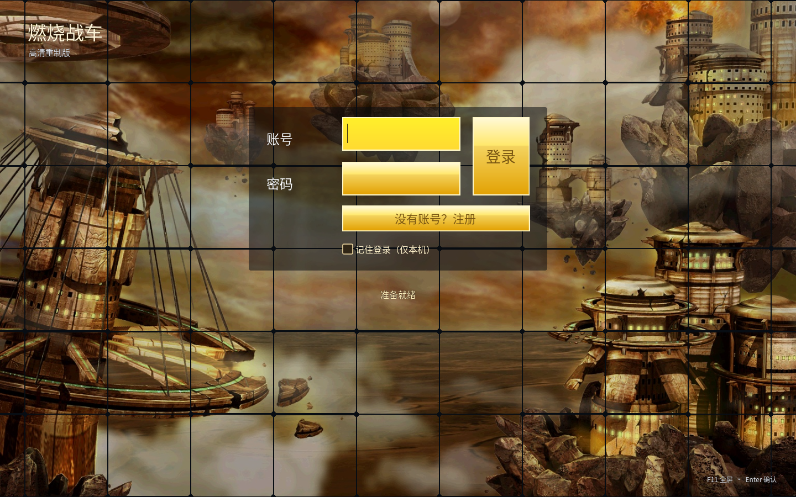

# 0.2.2 游戏内登录

本次改动参考光线飞车的方块拼图与表单排版，使用燃烧战车原版第 17 张地图背景。没有复制光线飞车的图片、Logo 或实现代码。

背景在原生窗口尺寸下分成方块；鼠标附近的方块抬升、倾斜，邻块轻微联动，移开后平滑复位。输入框保持固定位置，不随背景移动。注册页延续同一排版并增加确认密码，Windows 沿用 DPAPI 保存凭据，Web 沿用只保存令牌的浏览器会话。

登录后，原页面保留在关闭中的频道机械门后；门板完全覆盖后释放登录页，再显示原有频道选择。频道进入大厅的流程保持原有实现。Windows 启动仍由现有更新入口先检查文件更新，再启动游戏内登录。

## 本地验收

使用实际 Windows 导出包和单线程 Web 导出包，在非活动桌面及静音无头 Edge 中运行。鼠标输入验证了目标方块抬升、邻块响应、移开复位和表单稳定；布局覆盖 1000×650、1920×1080、2560×1440 与 430×900。真实注册、两次密码不一致、错误密码、退出重登、加密记住密码、取消记住、登录到频道动画及频道进入大厅均已测试。Web 验证没有明文密码存储，没有 JavaScript 或 Godot 运行错误。

复验命令如下，测试服只监听本机，命令不访问生产账号或房间。

```powershell
python 源码/tools/refresh_qa_server.py
python 源码/tools/qa_login_tiles.py --client .tools/client-login-final
python 源码/tools/qa_login_page.py --client .tools/client-login-final
python 源码/tools/qa_login_web.py --web .tools/web-login-final
```

0.2.2 使用同一套登录源码导出 Windows 与 Web。已有 Windows 客户端从更新入口启动，校验变更后进入新登录页；网页通过入口重新验证获取新版本。静态资源下载与游戏内登录分别显示进度。



[查看鼠标划过动效](images/login-0.2.2/hover.gif)

## 0.2.4 实体方块与划过音效

按参照模型的宽 128、厚 20 比例补齐前后盖、侧壁和灰色中芯，并随各面朝向计算明暗。[侧转图](images/login-0.2.4/login-solid.png)与[90° 侧面图](images/login-0.2.4/login-edge-on.png)来自实际 Windows 渲染，像素检查验证了厚度。

参照 `ui_screentile_00.xml` 指向七段 WAV，运行时随机选择。原 PCM 采样保持一致，仅清理 WAV 编辑器元数据以兼容 Godot 导入；原文件、分发文件与 PCM 哈希见 [音频来源](validation/login-audio-0.2.4.json)。登录流程检查覆盖实际主界面音效绑定，未在用户桌面播放声音。
