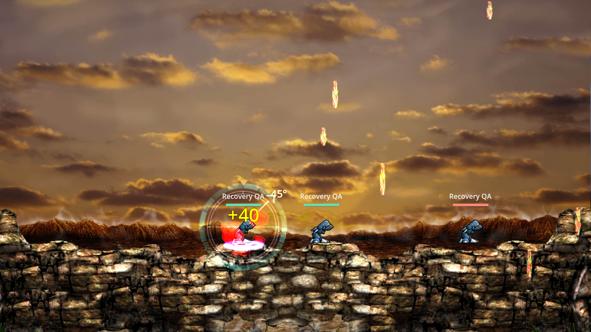
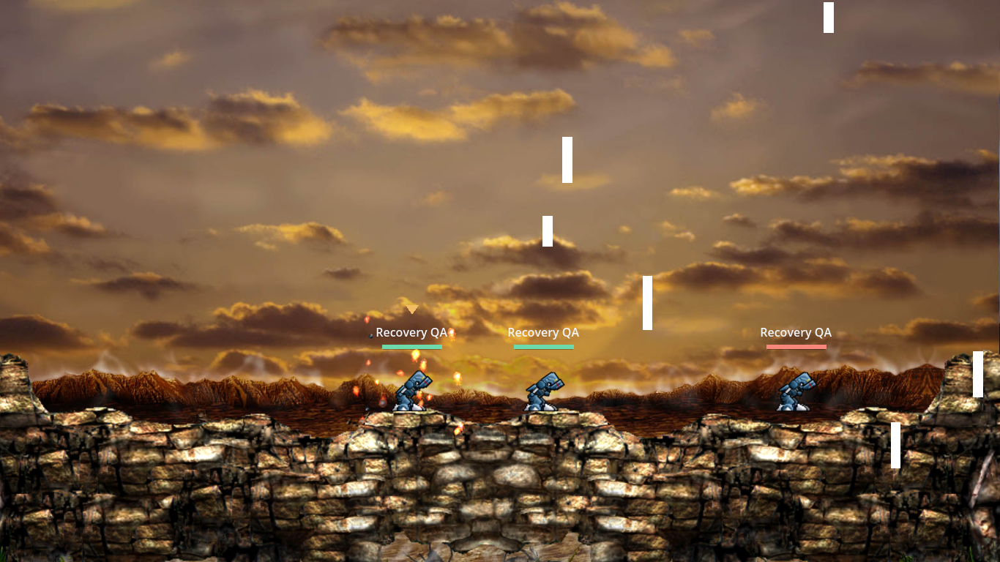

# 回血表现的原版依据

0.1.15 补齐的是回血反馈；生命计算、道具数量、回合和 SP 规则保持既有实现。

| 原版入口 | 已核对行为 | 当前对应 |
| --- | --- | --- |
| `0053d450` / `004b56f0` / `004b5570` / `004b57c0` | 小、大、团队补给使用者位置出现 `Effect30`，10 帧、每帧 5 刻、缩放 1.6、加法混合 | 原图支点和帧序渲染 |
| `004b7740` / `004b74b0` / `00480e70` | 同次道具产生 20 个 `Effect54` 光点，向上运动、缩小和淡出 | 独立粒子，按服务端绝对时间取样 |
| `00538500` | 生命受上限限制，初始化回血数字；团队其他受益者不各自生成道具光圈 | Go 快照显式传递光圈归属，各席位保留回血数字 |
| `00560830` / `004ae920` / `004ae700` / `00481050` | 治疗弹落点产生 20 个 `Effect03` 粒子，分别随机选 0–4 帧，150 刻渐隐；第 4 帧使用普通混合，其余为加法混合；恢复音为 56 | 独立粒子取代普通伤害爆炸和震屏 |

原版逻辑效果编号并不等于 SPR 文件名：道具光圈绑定 `Effect30`，上升光点绑定 `Effect54`。实现直接读取提取后的原始帧及支点，不用统一绿色光圈替换素材。

## 运行验证

最终 Windows 导出包在非活动 Windows 桌面、Dummy 音频驱动下执行：

- 85 项回血图形检查：帧序、20 光点、位置、透明度、团队归属、满血、燃料、隐形、迟到与过期、重复快照、同地图再开和 960×600／1920×1080／2560×1440 窗口。
- 50 项真实界面检查：注册、选择频道、购买三种补给、创建房间、开始对局、F5–F7 实际使用及原道具音只触发一次。
- 77 项战斗时间轴回归：伤害与地形时序、隐形、过期爆炸、结算及补给数字。
- Go 全量测试与 `go vet ./...` 通过，包含 `item_effect:false` 必须显式进入 JSON 的断言。

可从仓库根目录运行 `python 源码/tools/qa_recovery_effects.py`；指定 `--client <导出目录>` 可检查实际发行包。真实购买流程需使用隔离本地服务，不能用生产账号执行。

## 尚未证明的部分

救护道具的独立协议编号 105 复用治疗弹的原生恢复粒子；其专属原版特效绑定和精确作用半径尚未单独证明。粒子随机数为重制端确定性随机序列，不保证与旧程序任意一帧的随机图案一致。播放事件和资源已验证，静音自动化不替代听感验收。本次验证不表示全部技能已达到逐帧等价。
